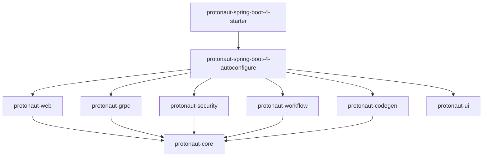

# Protonaut Architectural Blueprint

## 1. Executive Summary

**Protonaut** is an embedded developer library and interactive studio for gRPC applications built on **Java 25** and **Spring Boot 4.0.x**. Rather than deploying a standalone proxy or gateway requiring its own operational lifecycle, Protonaut is added as a lightweight dependency directly to host microservices.

```text
Host Spring Boot 4 Application
┌────────────────────────────────────────────────────────┐
│  Business Services (UserService, OrderService, ...)    │
│  gRPC Netty Server (Port 9090)                         │
├────────────────────────────────────────────────────────┤
│  Protonaut Embedded Studio                             │
│  - Port 6570: gRPC-compatible browser entry point      │
│  - Port 8590: Dedicated REST entry point               │
│  - Local Direct In-Process Channel (Zero-Latency)      │
└────────────────────────────────────────────────────────┘
```

---

## 2. Multi-Module Separation & Framework-Independent Core

A fundamental architectural mandate is that **the Protonaut core engine has zero dependency on Spring Boot or Spring Framework**.



### Module Responsibilities

| Module | Core Purpose | Framework Dependencies |
| :--- | :--- | :--- |
| `protonaut-bom` | Centralized Bill of Materials | None |
| `protonaut-core` | Models, SPIs, Descriptor Registry, Metadata Generator | **Zero** (Pure Java 25) |
| `protonaut-grpc` | Reflection, DynamicMessage Executor, Proto Reconstructor | Pure grpc-java / protobuf |
| `protonaut-security` | RBAC Principal, Sensitive Token Masking, Permission Model | Pure Java 25 |
| `protonaut-codegen` | Client Stubs (Java, Go, TypeScript, Python, C#) | Pure Java 25 |
| `protonaut-workflow` | Workflow Orchestration, Safe AST-Free Expression Evaluator | Pure Java 25 |
| `protonaut-ui` | Embedded React 18, TypeScript, Monaco Editor, Zustand SPA | None (Web assets) |
| `protonaut-web` | Embedded Netty HTTP Server, REST Dispatcher, Static Serving | Netty, Jackson |
| `protonaut-spring-boot-4-autoconfigure` | Spring Boot 4 Auto-Configuration & SmartLifecycle | Spring Boot 4, Spring 7 |
| `protonaut-spring-boot-4-starter` | Aggregate starter for consuming applications | Spring Boot 4 |

---

## 3. Dual-Port Network Architecture

Protonaut provides two distinct entry points designed for corporate firewalls, reverse proxies, and Kubernetes Ingress controllers:

1. **Port 6570 (`protonaut.grpc.port`)**:
   - The primary browser entry point.
   - Hosts the React SPA Web UI and the full REST dispatching engine.
   - Remains operational even when dedicated REST is disabled.
2. **Port 8590 (`protonaut.rest.port`)**:
   - A dedicated REST API endpoint.
   - Can be selectively disabled (`protonaut.rest.enabled = false`) without disrupting access on Port 6570.

### Port Conflict Handling

By default (`protonaut.execution.fail-fast-on-port-conflict = false`), Protonaut intercepts `BindException` or port collision errors, emits a clear warning in the console, and allows the host application to continue starting its business services normally.

---

## 4. Zero-Latency, Zero-SSRF In-Process Dispatching

Traditional external gRPC explorers make network HTTP/2 calls back to `localhost` or target IPs. This introduces network overhead, certificate complexities, and Severe SSRF (Server-Side Request Forgery) attack surfaces.

Protonaut eliminates this risk:
- On startup, `ProtonautLifecycleManager` binds discovered services into a local `InProcessServer`.
- `DynamicGrpcExecutor` dispatches calls directly through memory queues via `InProcessChannel`.
- All requests run within JVM memory with zero network latency, full metadata fidelity, and complete SSRF immunity.
