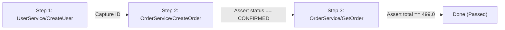

# Protonaut Workflow Studio Engine

## 1. Concept & Capabilities

The **Protonaut Workflow Studio** enables developers and QA engineers to compose, execute, and assert complex multi-step gRPC integration flows directly in their browser without writing test harnesses.

---

## 2. Dynamic Variable Propagation

Values produced by previous steps, environment variables, and workflow variables can be seamlessly injected into downstream step payloads or metadata using handlebars syntax:

| Syntax | Description | Example |
| :--- | :--- | :--- |
| `{{steps.<stepId>.response.<path>}}` | Field from earlier step response | `{{steps.create_user.response.id}}` |
| `{{vars.<variableName>}}` | Workflow-level variable | `{{vars.defaultSku}}` |
| `{{env.<variableName>}}` | Host system environment variable | `{{env.REGION}}` |
| `{{uuid}}` | Generates a random UUID v4 | `{{uuid}}` |
| `{{timestamp}}` | Current epoch millisecond timestamp | `{{timestamp}}` |

---

## 3. Safe, AST-Free Expression Evaluator

To prevent code injection, arbitrary script execution, and JVM escape vulnerabilities, Protonaut does **not** execute JavaScript, Groovy, or MVEL.

Instead, Protonaut includes a lightweight, secure token parser supporting deterministic operators:

| Operator | Supported Types | Semantics |
| :--- | :--- | :--- |
| `==` | String, Number, Boolean | Strict equality |
| `!=` | String, Number, Boolean | Inequality |
| `>`, `<` | Numeric | Greater than / Less than |
| `>=`, `<=` | Numeric | Greater or equal / Less or equal |
| `contains` | String, Array | Substring or element inclusion |
| `exists` | Any | Property present and not null |
| `not_exists` | Any | Property absent or null |
| `empty` | String, Array | Length == 0 |
| `not_empty` | String, Array | Length > 0 |

---

## 4. Retries & Backoff

Each workflow step can configure automated retries with exponential backoff:
- `retryCount`: Maximum number of attempts before marking step as failed.
- `retryDelayMs`: Initial delay between retries.
- `backoffMultiplier`: Exponential multiplier (e.g. 2.0).
- `skipCondition`: Safe expression evaluated before step execution; if true, the step is bypassed with status `SKIPPED`.
